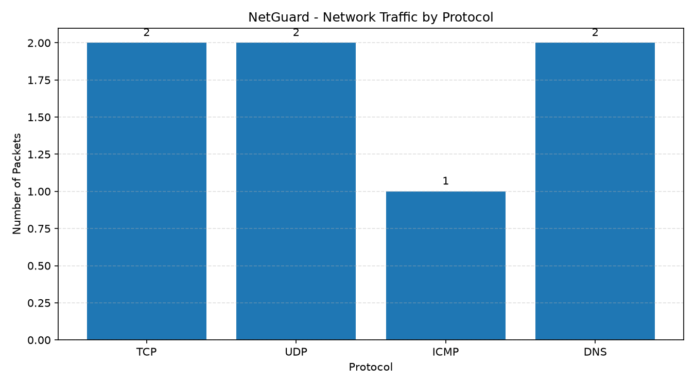

# NetGuard - Network Traffic Analysis Tool

NetGuard is a Python-based network traffic analysis tool that analyzes saved PCAP files, identifies network protocols, generates visual reports, and detects potential port-scanning activity.

This project was developed as a hands-on learning project to explore Python programming, network analysis, and basic cybersecurity threat detection.

## Features

- Packet analysis using Scapy.
- Identification of TCP, UDP, ICMP, DNS, and ARP traffic.
- Analysis of source and destination IP addresses.
- Extraction and counting of DNS query names.
- Basic detection of potential port-scanning activity.
- Configurable port-scan detection threshold.
- Export of traffic analysis results to timestamped CSV files.
- Export of threat alerts to a structured CSV report.
- Generation of protocol traffic charts using Matplotlib.
- Command-line support for analyzing different PCAP files.
- Synthetic packet captures for testing different scenarios.

## Technologies Used

- Python 3.12
- Scapy
- Pandas
- Matplotlib
- Git
- GitHub

## Project Structure

```text
NetGuard/
|-- data/
|   |-- sample_traffic.pcap
|   |-- port_scan_test.pcap
|   |-- empty_test.pcap
|   |-- non_ip_test.pcap
|-- reports/
|   |-- protocol_traffic.png
|   |-- threat_alerts.csv
|-- src/
|   |-- main.py
|   |-- packet_analyzer.py
|   |-- report_generator.py
|   |-- visualizer.py
|   |-- threat_detector.py
|   |-- threat_reporter.py
|   |-- create_sample.py
|   |-- create_threat_test.py
|   |-- create_empty_test.py
|   |-- create_non_ip_test.py
|-- .gitignore
|-- requirements.txt
|-- README.md
```

## Installation

### 1. Clone the repository

```bash
git clone https://github.com/prathvikumar/NetGuard.git
cd NetGuard
```

### 2. Create a virtual environment

```bash
python -m venv venv
```

### 3. Activate the virtual environment on Windows PowerShell

```powershell
.\venv\Scripts\Activate.ps1
```

### 4. Install the dependencies

```bash
python -m pip install -r requirements.txt
```

## Usage

### Analyze the default sample capture

```bash
python src/main.py
```

### Analyze a specific PCAP file

```bash
python src/main.py data/port_scan_test.pcap
```

### Configure the port-scan detection threshold

The default threshold is 10 distinct destination ports for the same source and destination IP address pair.

Use a lower threshold to detect activity involving fewer ports:

```bash
python src/main.py data/port_scan_test.pcap --port-threshold 5
```

Use a higher threshold to make the detector less sensitive:

```bash
python src/main.py data/port_scan_test.pcap --port-threshold 15
```

The threshold must be at least 2.

The application analyzes the selected capture and generates applicable reports and visualizations in the `reports` directory.

## Testing

NetGuard includes synthetic PCAP files for testing:

| Capture file | Purpose |
|---|---|
| `sample_traffic.pcap` | Demonstrates normal TCP, UDP, ICMP, and DNS analysis |
| `port_scan_test.pcap` | Demonstrates potential port-scan detection |
| `empty_test.pcap` | Tests handling of an empty capture |
| `non_ip_test.pcap` | Tests handling of ARP-only traffic |

These sample captures are generated for local testing and do not require sending traffic to external systems.

## Output

NetGuard can generate the following outputs:

- Timestamped CSV files containing traffic analysis results.
- `protocol_traffic.png`, a chart showing protocol packet counts.
- `threat_alerts.csv`, containing detected potential threat alerts.

The threat report includes the timestamp, alert type, source IP, destination IP, number of distinct destination ports, observed ports, severity, configured threshold, protocols, and detection reason.

### Protocol Traffic Visualization

The chart below shows protocol packet counts from the sample capture.



## How Threat Detection Works

NetGuard groups TCP and UDP traffic by source and destination IP address and counts distinct destination ports. When the configured threshold is reached, the tool flags the activity as a potential port scan.

The threshold is configurable through the `--port-threshold` command-line option. The default value is 10.

This is a basic detection heuristic. It can produce false positives and should not be treated as proof of an attack.

## Limitations

- The current version analyzes saved PCAP files; live network capture is not implemented.
- Detection is based on a simple threshold and may miss some attacks.
- DNS packets can also be counted under their transport protocol, so some protocol counts overlap.
- This educational project is not a replacement for a production intrusion detection system.

## Future Improvements

- Detect additional suspicious traffic patterns.
- Improve report filtering and visualization.
- Develop a graphical user interface.

## Author

Prathvi Kumar

GitHub: https://github.com/prathvikumar

## License

No open-source license has been added to this repository yet. Usage and redistribution remain subject to the author's rights unless a license is added.
